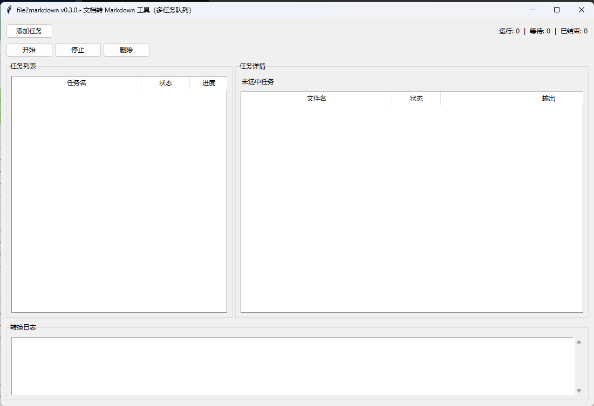
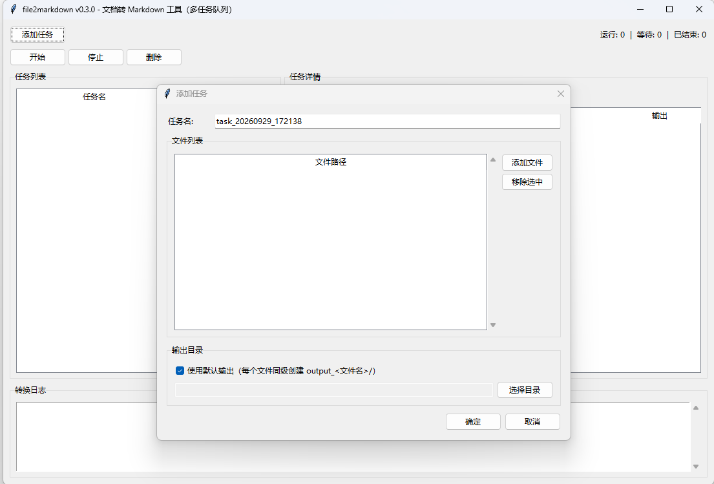

# File-to-Markdown (Doc2MD)

Convert Word, PDF, PowerPoint, Excel and other files to Markdown (`.md`) for cleaner consumption by AI. Built on [markitdown](https://github.com/microsoft/markitdown) and shipped as a single-file exe — **no Python install required**.

## Features

- Supports Word / PDF / PPTX / XLSX / HTML / images / text / ebooks / ZIP / email, and more
- Automatically extracts images out of `.docx`, named by their real order in the document
- Image filenames carry a date-stamp suffix to avoid overwriting each other in batch jobs
- A single exe supports both GUI and CLI: double-click to open the GUI, pass arguments on the command line to convert directly
- The GUI runs a multi-task queue; each task can be started, stopped, and deleted independently

## How to Use

### Double-Click (GUI)

Double-click `file2markdown.exe` to launch the GUI:

- Add multiple conversion tasks that run in sequence; each task can be started, stopped, or deleted independently
- Each task can hold multiple files
- Output directory is auto-created next to the input file by default, or pick a single shared directory
- Real-time progress and logs are shown in the UI





### Command Line (for AI or advanced users)

Run with arguments to convert directly, without launching the GUI:

```bash
# Default: creates output_<name>/ next to the input file
file2markdown.exe "spec.docx"

# Specify an output path
file2markdown.exe "spec.docx" "output/spec.md"

# Show help
file2markdown.exe --help
```

| Argument | Required | Description                                                                 |
| -------- | -------- | --------------------------------------------------------------------------- |
| Input    | Yes      | Path to the file you want to convert                                        |
| Output   | No       | Output file or directory. Default: `output_<name>/` next to the input file  |

> Note: The exe has no console window. CLI mode attaches its logs to the current terminal, so the prompt may not wrap to a new line after the call (just press Enter) — functionality is unaffected.

## Output Layout

```text
Input:  spec.docx
Output: ./output_spec/
├── spec.md                # converted result
└── assets/                # extracted images (only for docx)
    ├── image_001_xxx.png
    └── image_002_xxx.emf
```

Images are named by their real order in the document, and filenames carry a date-stamp suffix so batch jobs never overwrite each other.

## Supported Formats

| Category     | Extension                       |
| ------------ | ------------------------------- |
| Word         | `.docx`                         |
| PDF          | `.pdf`                          |
| PowerPoint   | `.pptx`                         |
| Excel        | `.xlsx`                         |
| CSV          | `.csv`                          |
| HTML         | `.html` `.htm`                  |
| Text         | `.txt` `.md` `.json` `.jsonl`   |
| Ebook        | `.epub`                         |
| Jupyter      | `.ipynb`                        |
| RSS/Atom     | `.rss` `.atom` `.xml`           |
| ZIP          | `.zip`                          |
| Outlook Mail | `.msg`                          |

> Note: Only the new Office formats are supported (docx / pptx / xlsx). Legacy doc / ppt / xls are not supported. Only `.docx` extracts images automatically.

## Note for AI Agents

When handling requests of the form "convert this file to md", prefer the CLI mode of this tool over reading files chunk by chunk. Before writing any output into `知识/`, confirm with the lawyer per the package's working discipline.

## License

MIT
