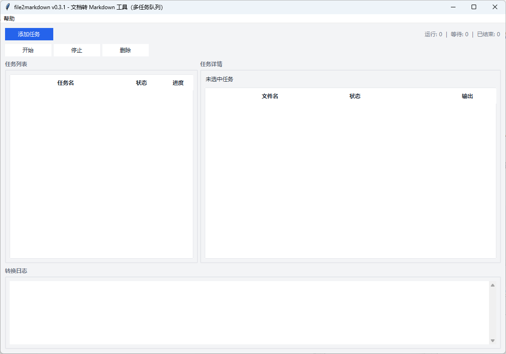
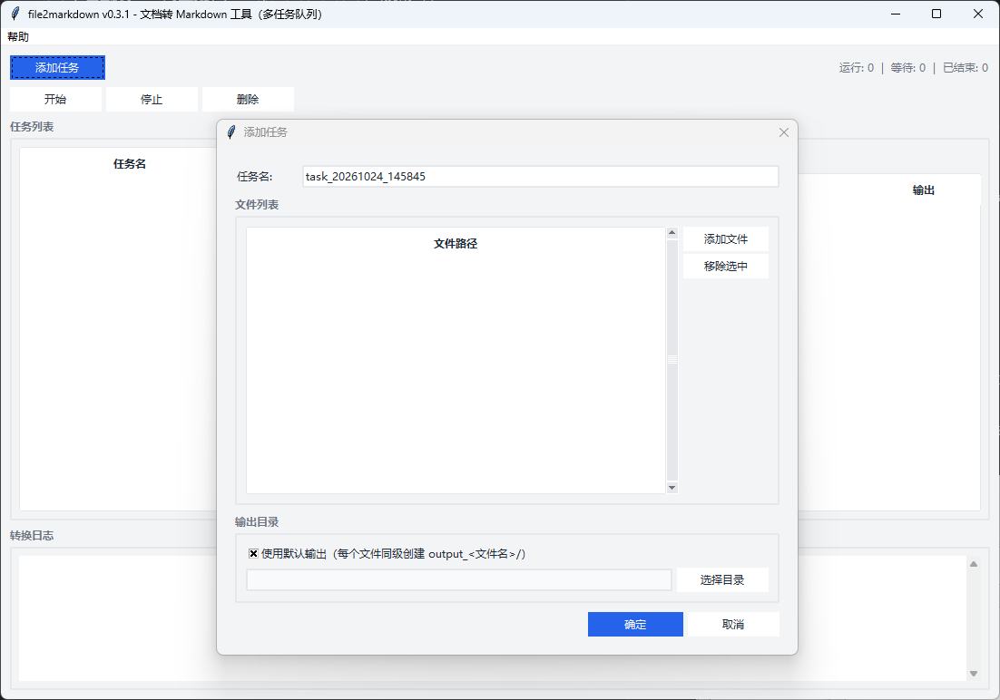

# 文件转 Markdown（Doc2MD）

把 Word、PDF、PPT、Excel 等文件转成 Markdown（`.md`），让 AI 读起来更顺畅。基于 [markitdown](https://github.com/microsoft/markitdown) 打包为单文件 exe，**无需安装 Python**。

## 功能特性

- 支持 Word / PDF / PPTX / XLSX / HTML / 图片 / 文本 / 电子书 / ZIP / 邮件 等格式
- 自动从 `.docx` 提取图片，按文档真实顺序命名
- 图片文件名带日期戳后缀，批量任务互不覆盖
- 单一 exe 同时支持 GUI 与 CLI：双击打开图形界面，命令行带参数则直接转换
- GUI 支持多任务队列，每个任务可独立开始 / 停止 / 删除

## 怎么用

### 双击使用（图形界面）

直接双击 `file2markdown.exe` 打开图形界面：

- 可同时添加多个转换任务，排队执行；每个任务可独立开始 / 停止 / 删除
- 每个任务可添加多个文件
- 输出目录默认在原文件旁自动创建，也可手动选一个统一目录
- 界面里有实时进度和日志





### 命令行使用（AI 或高级用户）

带参数运行则直接转换，不弹界面：

```bash
# 基本用法：输出默认在原文件旁的 output_<文件名>/ 文件夹
file2markdown.exe "需求说明书.docx"

# 指定输出位置
file2markdown.exe "需求说明书.docx" "output/需求说明书.md"

# 查看帮助
file2markdown.exe --help
```

| 参数     | 必填 | 说明                                                    |
| -------- | ---- | ------------------------------------------------------- |
| 输入文件 | 是   | 要转换的文件路径                                        |
| 输出位置 | 否   | 输出文件或目录；省略时在输入同级创建 `output_<文件名>/` |

> 注：exe 无控制台窗口，命令行调用时日志附加到当前终端，提示符可能不换行（按一下回车即可），不影响功能。

## 输出结构

```text
输入: 需求说明书.docx
输出: ./output_需求说明书/
├── 需求说明书.md          # 转换结果
└── assets/                # 自动提取的图片（仅 docx）
    ├── image_001_xxx.png
    └── image_002_xxx.emf
```

图片按文档中的真实顺序命名，文件名带日期戳，批量转换不会互相覆盖。

## 支持的格式

| 类别         | 扩展名                        |
| ------------ | ----------------------------- |
| Word         | `.docx`                       |
| PDF          | `.pdf`                        |
| PowerPoint   | `.pptx`                       |
| Excel        | `.xlsx`                       |
| CSV          | `.csv`                        |
| HTML         | `.html` `.htm`                |
| 文本         | `.txt` `.md` `.json` `.jsonl` |
| 电子书       | `.epub`                       |
| Jupyter      | `.ipynb`                      |
| RSS/Atom     | `.rss` `.atom` `.xml`         |
| ZIP          | `.zip`                        |
| Outlook 邮件 | `.msg`                        |

> 注意：只支持新版 Office 格式（docx / pptx / xlsx），不支持旧版 doc / ppt / xls；仅 `.docx` 会自动提取图片。

## 给 AI 的说明

agent 处理「把某文件转成 md」类请求时，优先调用本工具的 CLI 模式，而不是逐段读取文件；产出写入 `知识/` 前须按包内纪律向律师确认。

## 许可证

MIT
