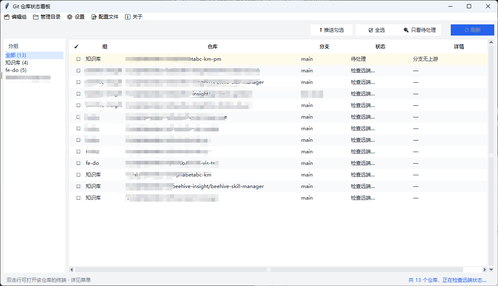

# Git Repo Checker

A local dashboard for managing multiple working directories at once and checking the sync status of every git repo underneath them: which repos have uncommitted changes, which are unpushed, which are behind remote — all at a glance. You can also tick multiple repos and batch `git push`. Packaged as a single-file exe built on Python tkinter — **no Python installation required**, only a local `git`.



## Features

- Manage working directories as "groups", with an `All` combined view
- Per-repo status: current branch, uncommitted changes (staged / unstaged / untracked), unpushed (ahead), unsynced (behind), no remote, branch without upstream
- Optional `git fetch` for accurate remote sync status (local results show first, remote refreshes in background)
- Tick multiple repos and batch `git push`, with a per-repo report afterwards
- "Pending only" one-click filter to show only repos that need attention
- Double-click any row to open Windows Terminal or Git Bash in that repo's directory
- Zero third-party dependencies: Python standard library + local `git` CLI only

## How to use

### 1. Configure working directories

On first launch there are no directories. Use the "🗂 Edit Groups" menu to add a group, then "📁 Manage Directories" to add working directories to it. The app recursively scans these directories (skipping `node_modules`, `.venv`, etc.) and lists every git repo it finds.

- A directory that is itself a git repo is included as-is, without descending into it
- Duplicate directories within a group are deduplicated automatically

### 2. Check status

Click "⟳ Refresh" to scan all groups. The table first shows local scan results (uncommitted changes etc.), then updates remote status (ahead / behind) automatically once the background fetch completes. Repos without local issues show "Checking remote…" in the meantime.

| Status  | Meaning                                                            | Row tint       |
| ------- | ------------------------------------------------------------------ | -------------- |
| Error   | git status parsing failed / timed out                              | light red      |
| Pending | uncommitted / no remote / no upstream / ahead / behind             | light orange   |
| Clean   | clean and in sync with remote                                      | white / stripe |

The "Details" column lists concrete items, e.g. `Uncommitted 3; Unpushed 2`.

### 3. Batch push

Tick the repos to push (or use "☑ Select All"), click "⬆ Push Selected", confirm, and each repo is pushed one by one. A `✔/✘` report pops up when done, followed by an automatic refresh.

> Push runs without `--set-upstream`: pushing fails when the branch has no upstream or the repo has no remote — set up the upstream manually in the repo first.

### 4. Open terminal quickly

Double-click any repo row to open a terminal in that repo's directory. Default is `auto`: Windows Terminal if installed, otherwise Git Bash; you can force `wt` or `gitbash` in "⚙️ Settings".

## Config file

Settings persist in the user home directory at `~/.git-repo-checker.json`:

```json
{
  "groups": {
    "Default": ["E:\\work\\a", "E:\\work\\b"]
  },
  "prefs": {
    "terminal": "auto"
  }
}
```

Open it for editing via the "📝 Config File" menu. Note: **edits made outside the app are not auto-reloaded — restart the app for them to take effect**.

## Known limitations

- Config file edits made outside the app require a restart to take effect
- Switching groups only filters the last refreshed data; it does not rescan
- The fetch phase is network-bound; more repos means a longer background refresh (16 concurrent, 15s timeout per repo)
- Repos nested inside a working directory that is itself a repo are not scanned
- A running scan cannot be cancelled
- The open-terminal feature targets Windows (`wt` / Git for Windows `bash`)

## License

MIT
